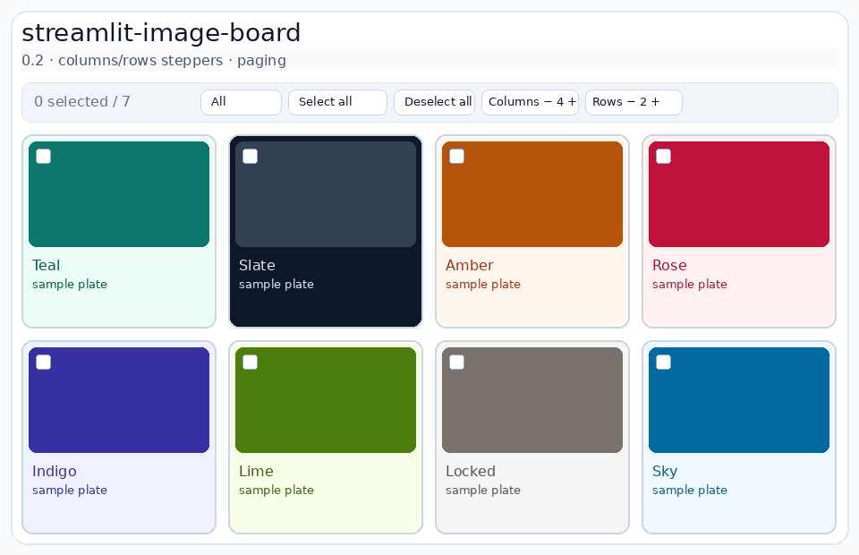

# streamlit-image-board



Snappy React **selectable image board** for Streamlit, built on **Components v2**
(same stack as [`streamlit-drawable-konva`](https://github.com/gsiogkas/streamlit-drawable-konva)).

Named **image-board** (not gallery) to avoid clashing with existing
`image-gallery` packages. Checkboxes, image-frame selection, hover text, styled
cards, and toolbar actions update **inside the widget** — no full Streamlit
rerun for every toggle.

## Features

- CSS grid of image cards (configurable columns / gap)
- Configurable **image click**: `select` | `open` | `none` (per item or board-wide)
- Optional **checkboxes** kept in sync with the same selection
- **Select all / Deselect all** + master **All** control
- **Hover text** overlay on thumbnails
- Stylable **label / caption / text chips / buttons**
- Per-card (and board-default) **background, text color, font**
- **JSON** items / full board config (file path, string, or dict)
- Shared checklist contract for **AgGrid** (classic + v2)
- Returns `selected_ids: list[str]` and `selected_csv`

## Install

```bash
pip install streamlit-image-board
# or editable:
pip install -e .
```

Frontend rebuild (developers):

```bash
cd streamlit_image_board/frontend
npm install
npm run build
```

Demo:

```bash
streamlit run app.py
```

## Quick start

```python
from streamlit_image_board import st_image_board

result = st_image_board(
    [
        {
            "id": "a",
            "src": "https://…",
            "label": "Alpha",
            "hover_text": "Alpha details on hover",
            "card_style": {
                "background": "#0f172a",
                "color": "#e2e8f0",
                "fontFamily": "Georgia, serif",
            },
            "texts": [
                {"text": "NEW", "variant": "badge"},
                {"text": "12 MB", "variant": "muted"},
            ],
        },
        {
            "id": "b",
            "image": pil_image,
            "label": "Beta",
            "caption": "from PIL",
            "background": "#fff7ed",
            "color": "#9a3412",
        },
    ],
    columns=4,
    selectable=True,
    image_click="select",  # or "open" / "none"
    show_select_all=True,
    selection_color="#0f766e",
    card_style={"background": "#ffffff", "color": "#0f172a"},  # board default
    buttons=[
        {"id": "approve", "label": "Approve", "variant": "primary"},
        {"id": "delete", "label": "Delete", "variant": "danger"},
    ],
    key="board",
)

ids = result.selected_ids   # ["a", "b"]
csv = result.selected_csv   # "a,b"
```

### Image click behavior

| `image_click` | Thumbnail click |
| --- | --- |
| `"select"` (default) | Toggle selection frame (same checklist as checkboxes) |
| `"open"` | Emit `clicked_button="open"` / `clicked_item`, and optionally `window.open` |
| `"none"` | No thumbnail action (checkboxes / buttons still work) |

Set board-wide via `image_click=…`, or per item with `"image_click": "open"`.  
Open target: item `open_url` / `href` / `link`, else `src`. Use `open_in_new_tab=False` to skip the browser tab and only emit the Streamlit event.

```python
result = st_image_board(
    [
        {
            "id": "shot",
            "src": "https://…/thumb.jpg",
            "label": "Full size",
            "open_url": "https://…/full.jpg",
            "image_click": "open",
        }
    ],
    image_click="open",
    open_in_new_tab=True,
    selectable=True,       # checkboxes still select
    show_checkboxes=True,
)
if result.clicked_button == "open":
    st.write("Opened", result.clicked_item)
```

### JSON input

Pass a path, JSON string, or dict — items only, or a full board config:

```python
from streamlit_image_board import load_board_config, st_image_board

# Items array file (see examples/items.json)
result = st_image_board("examples/items.json", columns=3, image_click="select")

# Full config: items + options (kwargs override file fields)
result = st_image_board(config="examples/board_config.json")

# Or load yourself
cfg = load_board_config("examples/board_config.json")
result = st_image_board(**cfg, key="from_json")
```

Helpers: `load_board_items`, `load_board_config`.

### Card chrome (font / background)

| Source | Keys |
| --- | --- |
| Board default | `card_style={...}` on `st_image_board` |
| Per item | `card_style` / `style`, or shortcuts `background`, `color`, `font_family` |
| Label / caption | `label_style`, `caption_style` |

Allowed style keys are sanitized (color, background, fontFamily, padding, …).

### Selection UX

- Click the **image** → depends on `image_click` (`select` / `open` / `none`)
- Optional **checkbox** uses the same checklist (independent of open mode)
- **All** / **Select all** / **Deselect all** in the toolbar
- Hover shows `hover_text` (falls back to `label`)

### `BoardResult`

| Field | Meaning |
| --- | --- |
| `selected_ids` | `list[str]` — checkbox **and** image clicks |
| `selected_csv` | Same ids as `"id1,id2"` |
| `clicked_button` | Last toolbar/card button id |
| `clicked_item` | Item id for card button / activation |
| `action_nonce` | Increments on each action so repeats are detectable |

Helpers: `result.as_list()`, `result.as_set()`, `result.to_aggrid_preselected(df)`.

`st_image_gallery` / `GalleryResult` remain as thin aliases.

## AgGrid checklist bridge (classic + v2)

Shared contract: **`list[str]` of stable ids** (plus optional CSV). Both the
image board and AgGrid read/write that checklist.

```python
from st_aggrid import AgGrid, GridOptionsBuilder, GridUpdateMode
from streamlit_image_board import (
    configure_aggrid_selection,
    st_image_board,
    sync_checklist,
)

board = st_image_board(items, selected_ids=st.session_state.get("shared_selection", []))

gb = GridOptionsBuilder.from_dataframe(df)  # df must include an "id" column
configure_aggrid_selection(gb, st.session_state.get("shared_selection", []), data=df)
grid = AgGrid(df, gridOptions=gb.build(), update_mode=GridUpdateMode.SELECTION_CHANGED)

sel = sync_checklist(
    session_state=st.session_state,
    key="shared_selection",
    board=board,
    aggrid=grid,
    id_column="id",
)
```

| Helper | Role |
| --- | --- |
| `normalize_selected_ids` | Coerce any payload → `list[str]` |
| `selected_ids_from_aggrid` | Read AgGrid `selected_rows` |
| `aggrid_preselected_rows` | Map ids → `pre_selected_rows` indices |
| `configure_aggrid_selection` | Wire `GridOptionsBuilder.configure_selection` |
| `sync_checklist` | Bidirectional session sync board ↔ AgGrid |
| `filter_rows_by_ids` | Slice a DataFrame / row list by the checklist |

Optional extras: `pip install 'streamlit-image-board[aggrid]'` or `[aggrid-v2]`.

## Publishing

Step-by-step GitHub / PyPI / Streamlit Cloud / gallery:
**[PUBLISHING.md](PUBLISHING.md)**.

Refresh the usage GIF:

```bash
uv run python scripts/make_usage_gif.py
# or record from the live demo — see PUBLISHING.md
```

## Requirements

- Python ≥ 3.10
- Streamlit ≥ 1.51 (Components v2)
- Pillow
- Node ≥ 18 (frontend build only)
